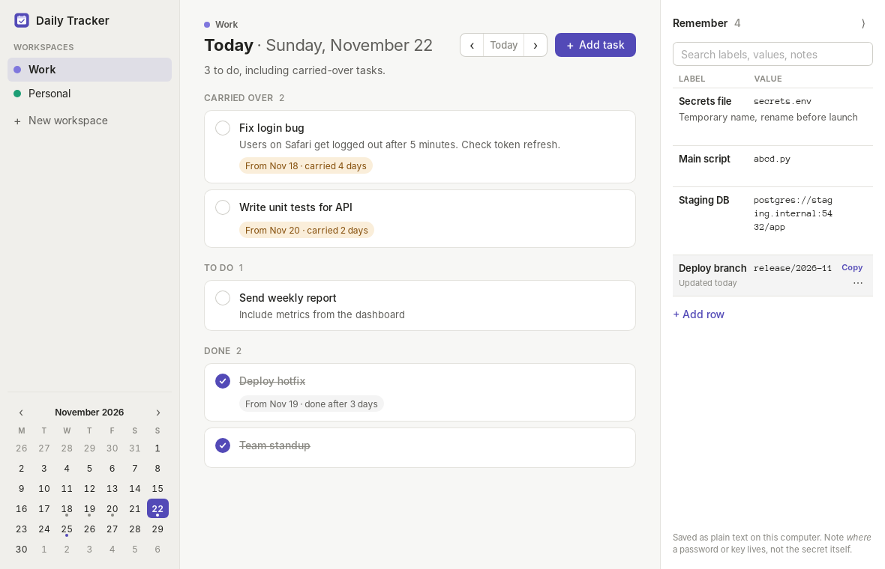

# Daily Tracker

A simple, lightweight desktop app for your daily work: plan tasks by date, get reminders, track time, and let unfinished work carry over automatically. Runs on **macOS, Windows and Linux**. Your data stays on your computer.

### [⬇ Download for macOS, Windows or Linux](https://potalatarun.github.io/daily-tracker/)



## Features

- **Tasks by date:** pick a date, add a title, description and as many reminders as you like.
- **Automatic carry-over:** unfinished tasks show up in Today with their original date and how many days they've been carried.
- **Reminders that work:** native notifications, even with the window closed. Snooze for any length of time. Missed reminders are summarised when you come back.
- **Time tracking:** start, pause and resume; see how long a task really took.
- **Workspaces:** keep Work, Personal, or anything else separate.
- **Remember panel:** a permanent per-workspace table for names, paths and decisions you don't want to forget.
- **Light and fast:** ~10 MB installer, starts instantly, lives in your tray.

## Documentation

| Doc | What's in it |
|---|---|
| [Product spec](docs/SPEC.md) | What the app does and how it behaves |
| [System design](docs/ARCHITECTURE.md) | Architecture, data model, scheduler, carry-over, release pipeline, with diagrams |
| [Design decisions](docs/DECISIONS.md) | Every major trade-off and why we made it |
| [Releasing](docs/RELEASING.md) | How installers are built and published, and how auto-update works |

## Install

Go to the **[download page](https://potalatarun.github.io/daily-tracker/)**. It picks the right file for your computer. Or grab one from the [latest release](https://github.com/potalatarun/daily-tracker/releases/latest).

| | How to install | First time you open it |
|---|---|---|
| **macOS** (Apple Silicon & Intel) | Open the `.dmg`, drag **Daily Tracker** into **Applications** | macOS says it can't verify the app → click **Done**, then **System Settings → Privacy & Security → Open Anyway** |
| **Windows** 10 / 11 | Run the `…-setup.exe`. No admin rights needed. | “Windows protected your PC” → **More info → Run anyway** |
| **Linux** | Ubuntu/Debian: `.deb` · Fedora: `.rpm` · any distro: `.AppImage` (make it executable, then open) | No warning |

The one-time warning appears because the app isn't signed with a paid Apple/Microsoft certificate yet. The installers are built by GitHub Actions straight from this public code.

**After installing:**
- A short setup asks for your workspaces, lets you send a test notification, and offers to **start at login** so reminders always work.
- Closing the window keeps Daily Tracker running in the **tray / menu bar**. Use **Quit** in the tray menu to stop it.
- **Updates install themselves:** when a new version is out, a bar offers **Update & restart**. Settings → *Check for updates* checks right away.
- **Moving to a new computer:** Settings → *Export…* on the old one; on the new one choose *Import a backup* in the first-run setup.
- **Uninstall** like any other app. Your data stays in the app-data folder (below) unless you first use Settings → *Delete all my data*.

## Build from source

For developers who want to run or change the code. Regular users should use the installer above.

### 1. Install the prerequisites (once)

Every OS needs **[Node.js 26 LTS](https://nodejs.org)** (download the "LTS" installer; `npm install` stops with an "Unsupported engine" error on older versions) and **Rust**.

**Install Rust:**
- macOS / Linux:
  ```bash
  curl --proto '=https' --tlsv1.2 -sSf https://sh.rustup.rs | sh
  source "$HOME/.cargo/env"
  ```
- Windows: download and run **rustup-init.exe** from [rustup.rs](https://rustup.rs), then **close and reopen your terminal**.

Check it worked: `cargo --version` should print a version. If you see `failed to run 'cargo metadata'` later, Rust isn't installed or your terminal hasn't picked it up yet, so open a new terminal.

Then the OS-specific pieces:

<details>
<summary><b>macOS</b></summary>

```bash
xcode-select --install
```
</details>

<details>
<summary><b>Windows</b></summary>

- Install [Microsoft C++ Build Tools](https://visualstudio.microsoft.com/visual-cpp-build-tools/) and tick **"Desktop development with C++"**.
- WebView2 is already included in Windows 10 (recent updates) and Windows 11.
</details>

<details>
<summary><b>Linux (Debian / Ubuntu)</b></summary>

```bash
sudo apt update
sudo apt install libwebkit2gtk-4.1-dev libgtk-3-dev libayatana-appindicator3-dev \
  librsvg2-dev libssl-dev build-essential curl wget file
```
For Fedora, Arch and others, see the [Tauri prerequisites](https://v2.tauri.app/start/prerequisites/).
</details>

### 2. Run it

```bash
git clone https://github.com/potalatarun/daily-tracker.git
cd daily-tracker
npm install
npm run tauri dev
```

The first run compiles the Rust core, which takes a few minutes. After that it starts in seconds and reloads when you edit the UI.

### 3. Useful commands

| Command | What it does |
|---|---|
| `npm run tauri dev` | Run the app with live reload |
| `npm run tauri build` | Build an installer for your OS (in `src-tauri/target/release/bundle/`) |
| `npm run version:set 0.2.0` | Set the version everywhere before a release ([guide](docs/RELEASING.md)) |
| `npm run check` | Type-check the UI |
| `cd src-tauri && cargo test` | Run the core's unit tests |

### Project layout

```
src/                 Svelte + TypeScript UI
src-tauri/src/
  commands/          functions the UI calls
  services/          business rules (workspaces, tasks, reminders, ...)
  db/                SQLite connection and migrations
docs/                spec, system design, decisions, releasing
site/                the download page (GitHub Pages)
.github/workflows/   ci.yml (every PR) · release.yml (installers) · pages.yml (download page)
```

Your data is stored in `daily-tracker.sqlite` inside the app-data folder (`~/Library/Application Support/com.potalatarun.dailytracker` on macOS, `%APPDATA%\com.potalatarun.dailytracker` on Windows, `~/.local/share/com.potalatarun.dailytracker` on Linux).

## License

[MIT](LICENSE)
