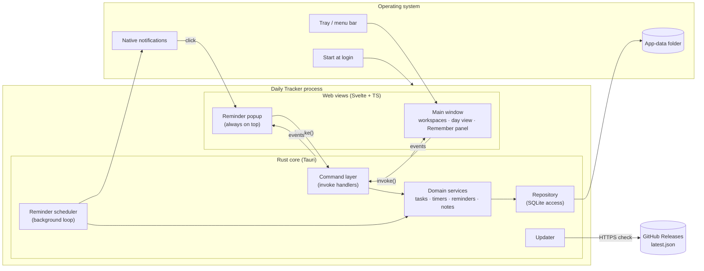
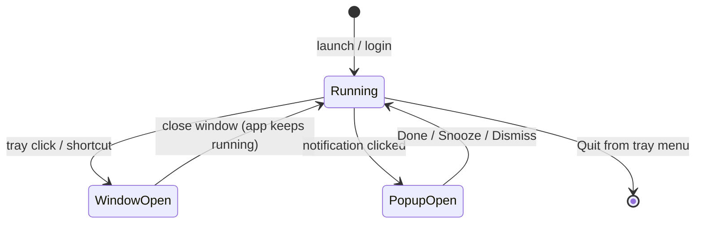
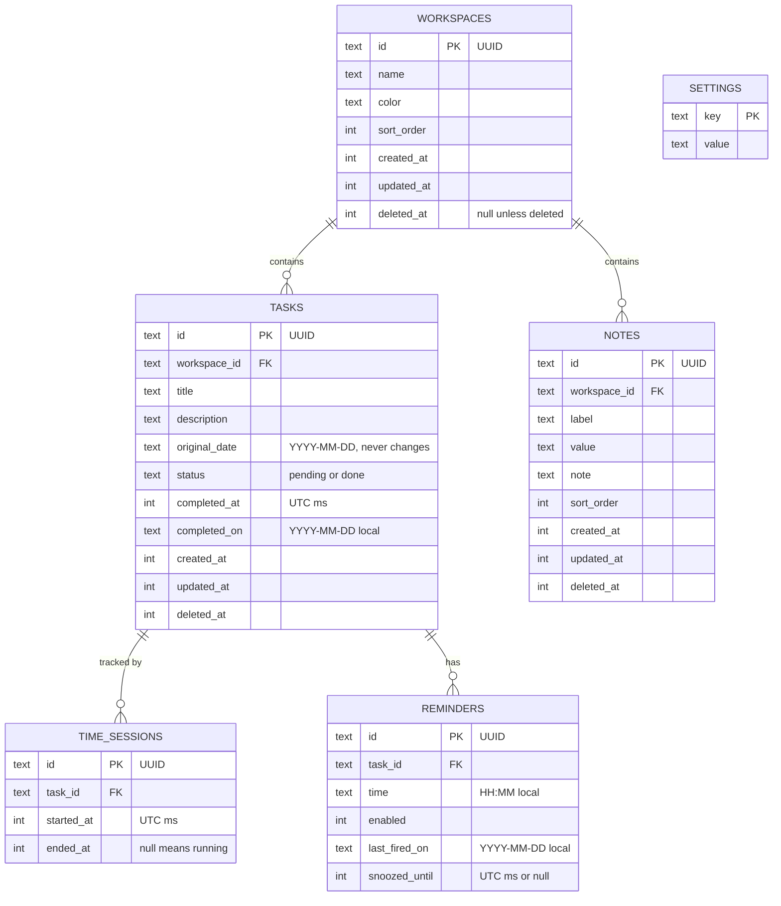
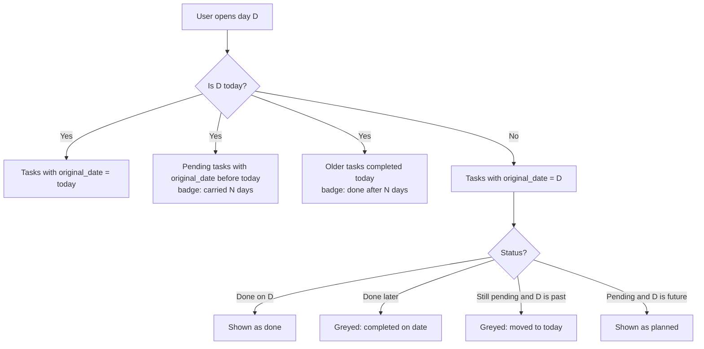
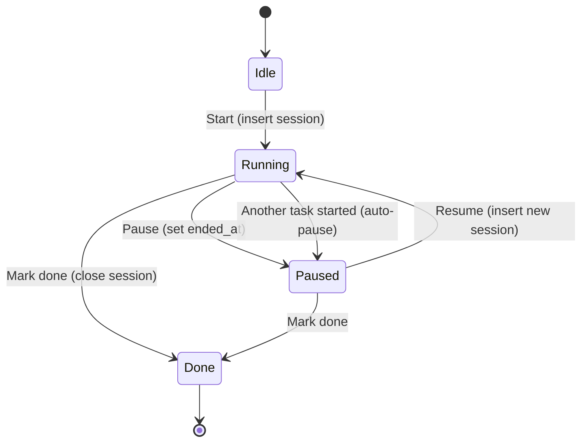
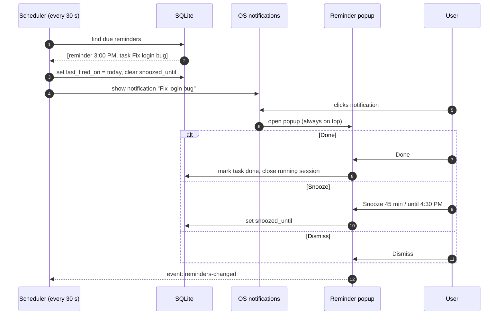
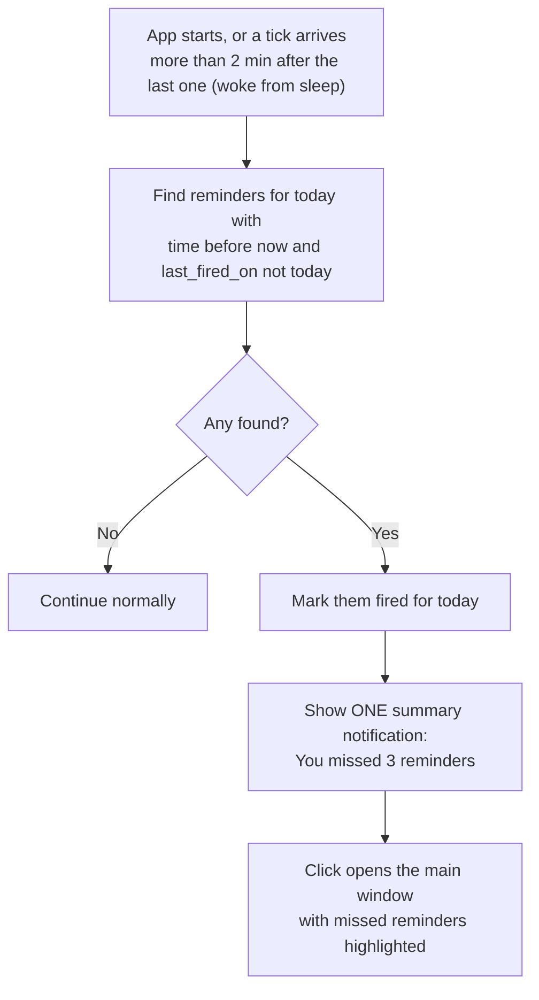
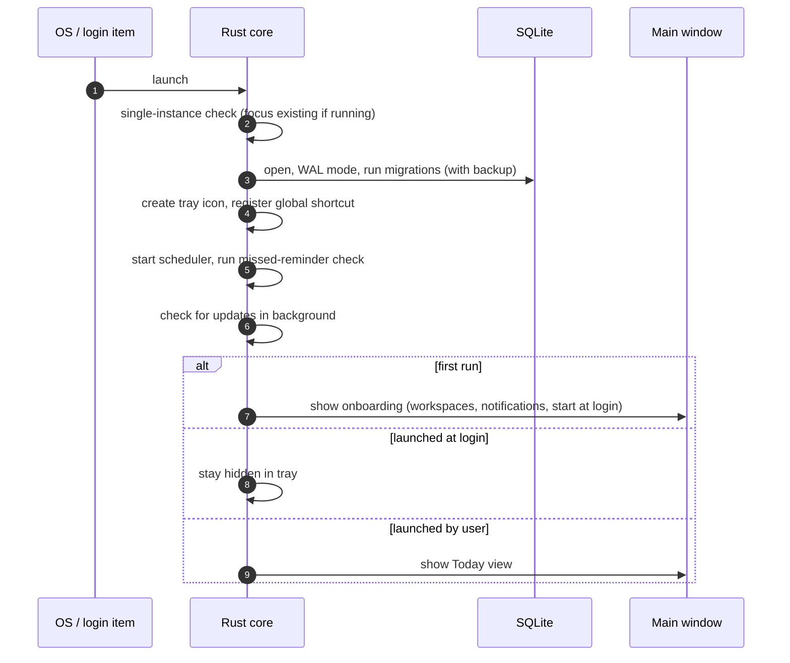
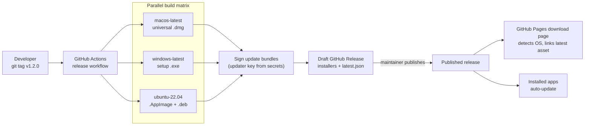
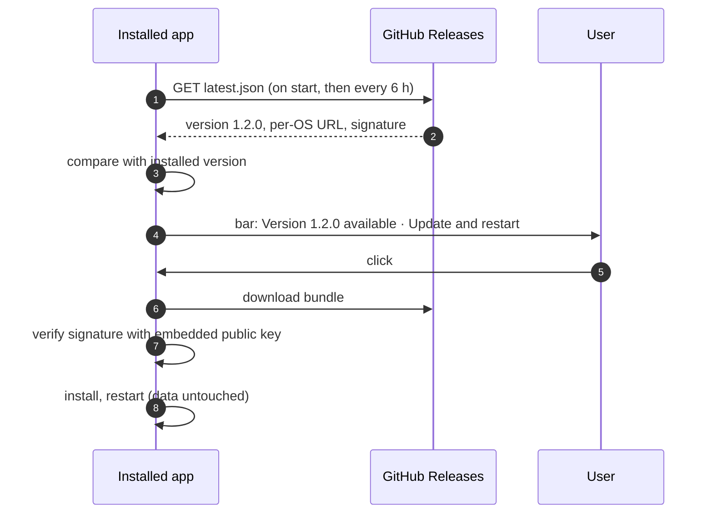

# Daily Tracker — System Design

This document explains **how Daily Tracker is built and why**. It is written for contributors and for anyone curious about the internals. For the reasoning behind each major trade-off, see [DECISIONS.md](DECISIONS.md). For the product behaviour, see [SPEC.md](SPEC.md).

---

## 1. Goals and constraints

| Goal | What it means for the design |
|---|---|
| **Simple** | One window, one form to add a task, no account, no setup beyond one first-run screen. |
| **Lightweight and fast** | Small installer (~5–10 MB), low memory (~30–60 MB), instant start. Rules out Electron. |
| **Works on macOS, Windows and Linux** | One codebase, built for all three by CI. |
| **Installable by non-developers** | Double-click installers, an OS-detecting download page, automatic updates. |
| **Reminders that actually fire** | Scheduling must live in a background process, not in the UI, and survive the window being closed. |
| **Private by default** | All data stays on the user's machine. No server, no telemetry. |
| **Ready for sync later** | Data model uses UUIDs and change timestamps so cloud sync can be added without migration pain. |

---

## 2. High-level architecture

Daily Tracker is a **local-first desktop app** built with [Tauri 2](https://tauri.app). A small Rust core owns the data, the scheduler and all OS integration. The UI is a Svelte app rendered in the OS's built-in web view (WebKit on macOS/Linux, WebView2 on Windows), so no browser engine is bundled.



### Responsibilities

| Layer | Owns | Does **not** do |
|---|---|---|
| **UI (Svelte)** | Rendering, forms, local view state, keyboard shortcuts | Business rules, timers, scheduling, direct file access |
| **Command layer** | Typed entry points the UI calls (`create_task`, `start_timer`, `snooze_reminder`…), input validation | Holding state |
| **Domain services** | Carry-over rules, time-session rules (one active timer), reminder rules, workspace cascade delete | SQL details |
| **Repository** | All SQL, migrations, transactions | Business rules |
| **Scheduler** | Deciding *when* a reminder fires, missed-reminder detection, wake-from-sleep detection | Rendering |
| **Updater** | Checking GitHub for new signed versions, install + restart | — |

The rule of thumb: **the UI is a view, the Rust core is the source of truth.** Any window (main or popup) can be closed or reopened at any time without losing state, and both stay in sync through events emitted by the core.

---

## 3. Process and window model



- **Closing the main window does not quit the app.** The process stays in the tray so the scheduler keeps running. Quitting is an explicit tray-menu action.
- **One process, several windows.** The main window and the reminder popup are separate web views of the same process, so they share one database connection and one scheduler.
- **Single instance.** Launching the app twice focuses the existing window instead of starting a second scheduler (which would fire every reminder twice).

---

## 4. Data model

Stored in a single SQLite file in the OS app-data folder:

| OS | Location |
|---|---|
| macOS | `~/Library/Application Support/com.potalatarun.dailytracker/` |
| Windows | `%APPDATA%\com.potalatarun.dailytracker\` |
| Linux | `~/.local/share/com.potalatarun.dailytracker/` |



### Conventions

- **IDs are UUIDs**, not auto-increment integers, so records created on two devices never collide when sync is added.
- **Every mutable table has `updated_at` and `deleted_at`** (soft delete). A future sync engine only needs "everything changed since X".
- **Two kinds of time are kept separate:**
  - *Instants* (`started_at`, `completed_at`, `snoozed_until`) are **UTC milliseconds**. Durations stay correct across time-zone changes and daylight-saving shifts.
  - *Calendar concepts* (`original_date`, `completed_on`, reminder `time`) are **local wall-clock values**. "3:00 PM" means 3:00 PM wherever the user is today.
- **Derived values are computed, not stored.** Carry count and total tracked time are calculated on read, so they can never drift out of sync.
- **Indexes** on `tasks(workspace_id, original_date, status)`, `tasks(workspace_id, completed_on)`, `reminders(task_id)` and `time_sessions(task_id)` keep the day view under a millisecond even with years of history.
- **Migrations** are numbered SQL files applied on startup inside a transaction. The database is backed up automatically before a migration runs.

---

## 5. Core behaviours

### 5.1 Automatic carry-over

**Key decision:** tasks are **never copied or moved**. A task keeps its `original_date` forever, and "today" is a *query*, not a write. This means there is no midnight job that can fail, no duplicate tasks, and the carry count is always correct even if the app was closed for a week.

What a day view shows, for a selected date `D` in a workspace:



- `carry_days = today − original_date` (calendar days, local time zone), computed on read.
- `done_after_days = completed_on − original_date`.
- **One source of "today":** the UI never trusts its own clock for the date. It asks the core (`get_today`), so the window and the core can't disagree around midnight or across time-zone changes.
- **Day rollover:** every 30 s, and whenever the window regains focus, the UI asks the core for today's date. If it changed while the user was looking at Today, the view moves to the new day and re-queries. Nothing is rewritten in the database. (Once the reminder scheduler lands, the core will push a `day-changed` event instead of the UI polling.)
- **Rescheduling:** editing a task's date is an explicit user action, so its carry count restarts from the new date.
- **Delete is undoable:** tasks are soft-deleted and a toast offers Undo.

### 5.2 Time tracking (pause and resume)

Each Start → Pause span is one row in `time_sessions`. A running session has `ended_at = null`.



- **Total time = sum of `(ended_at or now) − started_at`.** Example: 1 h Monday + 2 h Tuesday = 3 h, not ~26 h elapsed.
- **Only one timer runs at a time.** Starting a task closes any other open session in the same database transaction, so there can never be two running timers.
- **Timestamp-based, not tick-based.** Nothing counts seconds in the background. Closing the window, quitting or sleeping the laptop cannot lose time; the UI just renders `now − started_at` once per second while visible.
- Sessions can be edited manually (forgotten pause), with validation that sessions don't overlap and `ended_at > started_at`.

### 5.3 Reminder scheduler

The scheduler is a single background task in the Rust core. It wakes every **30 seconds** and evaluates which reminders are due. 30 s is a deliberate trade-off: reminders land within half a minute of their time while using effectively zero CPU.

A reminder is **due** when all of these are true:
1. its task is `pending` and not deleted, and the task is visible today (`original_date ≤ today`);
2. the reminder is `enabled`;
3. either `snoozed_until ≤ now`, **or** (`time ≤ now` and `last_fired_on ≠ today` and not snoozed).



- **Carried tasks repeat their reminders.** Because `last_fired_on` is a date, a 3:00 PM reminder fires again at 3:00 PM on every day the task is still pending. Users can edit, add or remove reminder times at any time.
- **Writes happen before the notification.** `last_fired_on` is written first, so a crash right after can never cause a duplicate on restart.
- **Why a popup window instead of notification buttons?** Desktop notification action buttons and text inputs are inconsistent across macOS, Windows and Linux. A small app-owned popup works identically everywhere and makes *custom* snooze durations possible. See [DECISIONS.md → D7](DECISIONS.md#d7-reminder-popup-window-instead-of-notification-buttons).

### 5.4 Missed reminders (app closed, PC off, laptop asleep)



- One summary notification, not a burst of ten.
- Only **today's** missed reminders are summarised. Reminders from previous days don't need catching up, because carried tasks get today's reminders again.

### 5.5 Startup sequence



Target: **window visible in under 500 ms** on a typical laptop. The UI loads the current day first; everything else (update check, calendar dots for other days) loads afterwards.

---

## 6. Remember panel

A per-workspace key/value table (`label`, `value`, `note`) shown on the right of the main window. It is independent of dates: rows persist until the user deletes them.

- Switching workspace switches the panel.
- Search filters label, value and note as you type, in the UI, since a workspace holds at most a few hundred rows.
- **Not for secrets.** Values are stored as plain text in SQLite. The UI shows a hint to store *where* a secret is (`secrets.env`), not the secret itself. Keychain-backed rows are a possible future feature.

---

## 7. Build, release and distribution



- **CI on every pull request** builds all three platforms and runs tests, so a change that breaks Windows is caught before merge.
- **Linux is built on Ubuntu 22.04** (older glibc) so the AppImage runs on more distributions.
- **Windows installer is per-user** (no admin prompt) and bootstraps WebView2 if missing.
- **Code signing is off for now** (free). Users see a one-time OS warning; the download page and README show how to open the app anyway. The workflow is already structured so Apple / Windows signing only requires adding secrets later.

### Update flow



The updater's **public key is embedded in the app** and the private key lives only in GitHub Secrets. A tampered or fake update fails verification and is rejected.

---

## 8. Bottlenecks and how they are handled

| Risk / bottleneck | Impact | Mitigation |
|---|---|---|
| Reminders not firing because the window is closed | Core feature broken | Scheduler lives in the Rust core; window close keeps the app in the tray; start-at-login on by default |
| PC off or asleep at reminder time | Silent missed reminders | Startup and wake-gap detection, one summary notification |
| Two app instances running | Every reminder fires twice | Single-instance plugin |
| Native file-drop handler swallowing in-page drag events (notably on Windows) | Drag-to-reorder silently broken | Window `dragDropEnabled: false`; the app never needs files dropped on it |
| Midnight carry-over job failing or running twice | Lost or duplicated tasks | No job: carry-over is a query on `original_date` |
| Timer drift / lost time when sleeping or quitting | Wrong durations | Store start/end instants, compute on read |
| Time-zone or DST change | Reminders at wrong time, wrong durations | Instants in UTC, reminder times and dates as local wall-clock |
| Database corruption on crash or power loss | Data loss | SQLite WAL mode + transactions; auto backup before migrations; JSON export |
| Notification permission denied | No reminders, user doesn't know why | Checked at startup; persistent banner with "Fix this" link |
| Inconsistent notification buttons across OSes | Custom snooze impossible on some OSes | App-owned popup window |
| Unsigned app warnings scare non-developers | Users give up installing | Illustrated "first open" guide on download page; signing can be added later |
| Large bundle / slow start | Feels heavy | Tauri (system web view), Svelte (no runtime framework), load today first |
| Growing history over years | Slow queries | Indexed queries scoped to one day and one workspace |
| Future multi-device sync | Expensive rewrite | UUIDs, `updated_at`, soft deletes from day one |

---

## 9. Planned repository layout

```
daily-tracker/
├── src/                    # Svelte + TypeScript UI
│   ├── lib/api/            # typed wrappers around Tauri invoke()
│   ├── lib/components/     # TaskItem, AddTaskForm, RememberPanel, ...
│   ├── routes/             # main window, popup window, onboarding
│   └── styles/
├── src-tauri/              # Rust core
│   ├── src/
│   │   ├── commands/       # invoke handlers (thin)
│   │   ├── services/       # tasks, timers, reminders, notes, workspaces
│   │   ├── scheduler.rs    # reminder loop, missed / wake detection
│   │   ├── db/             # repository + migrations/*.sql
│   │   ├── tray.rs
│   │   └── main.rs
│   ├── icons/
│   └── tauri.conf.json
├── site/                   # GitHub Pages download page
├── docs/                   # this documentation
└── .github/workflows/      # ci.yml, release.yml, pages.yml
```

---

## 10. Out of scope for v1

Cloud sync and accounts, mobile apps, recurring tasks, secret storage in the OS keychain, idle detection for timers, code signing. The data model and layering are designed so each of these can be added without restructuring.
