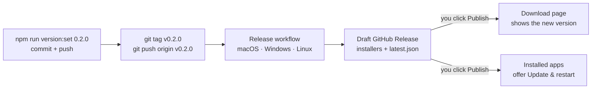

# Releasing Daily Tracker

How installers get built and published, and how installed apps update themselves. For the design behind it, see [ARCHITECTURE.md §7](ARCHITECTURE.md#7-build-release-and-distribution).



---

## One-time setup (≈ 5 minutes)

### 1. Create the updater signing key (on your own computer)

Auto-updates are signed so that nobody else can push a fake update to your users. You create the key pair once; the **private key stays with you and in GitHub Secrets only**.

```bash
cd daily-tracker
npx tauri signer generate -w ~/.tauri/daily-tracker.key
```

- It asks for a password. Choose one and remember it (or press Enter for none).
- It creates two files:
  - `~/.tauri/daily-tracker.key`: the **private** key. Never commit or share it. **Back it up** (password manager, encrypted drive). If it's lost, existing installs can't auto-update anymore and users would have to reinstall once.
  - `~/.tauri/daily-tracker.key.pub`: the **public** key. Safe to share; it goes into the app.

### 2. Put the public key in the app

Open `src-tauri/tauri.conf.json` and replace `REPLACE_WITH_UPDATER_PUBLIC_KEY` with the **entire contents** of `~/.tauri/daily-tracker.key.pub` (one long line). Commit and push.

Until this is done, update checks are switched off and the release workflow refuses to publish.

### 3. Add the private key to GitHub Secrets

GitHub → repository → **Settings → Secrets and variables → Actions → New repository secret**:

| Name | Value |
|---|---|
| `TAURI_SIGNING_PRIVATE_KEY` | the entire contents of `~/.tauri/daily-tracker.key` |
| `TAURI_SIGNING_PRIVATE_KEY_PASSWORD` | the password from step 1 (leave the secret empty or skip it if you chose none) |

Quick way to copy the key: `cat ~/.tauri/daily-tracker.key | pbcopy` (macOS) or `clip < %USERPROFILE%\.tauri\daily-tracker.key` (Windows).

### 4. Turn on the download page

GitHub → repository → **Settings → Pages → Build and deployment → Source: GitHub Actions**.

The page deploys automatically whenever `site/` changes on `main` (or run the "Download page" workflow by hand from the Actions tab). It will live at **https://potalatarun.github.io/daily-tracker/**.

---

## Making a release

```bash
git checkout main && git pull
npm run version:set 0.2.0          # updates package.json, package-lock.json, Cargo.toml
git commit -am "Release 0.2.0"
git push
git tag v0.2.0
git push origin v0.2.0
```

Then:

1. **Actions tab → Release.** Three builds run in parallel (≈ 15–25 min the first time, faster later thanks to caching).
2. **Releases page → the new draft.** Check that it has the installers (`.dmg`, `-setup.exe`, `.msi`, `.deb`, `.rpm`, `.AppImage`), their `.sig` files and `latest.json`. Edit the notes if you like ("What's new").
3. Click **Publish release**.

That's it:
- The **download page** links to the new files immediately (it reads the latest release live).
- **Installed apps** find the update within 6 hours (or at next launch) and show "Daily Tracker 0.2.0 is available · Update & restart". Settings → "Check for updates" checks right away.

### If something goes wrong

| Problem | Fix |
|---|---|
| "Tag vX doesn't match package.json version" | Run `npm run version:set X.Y.Z`, commit, delete the tag (`git push --delete origin vX.Y.Z && git tag -d vX.Y.Z`) and tag again. |
| "Add the TAURI_SIGNING_PRIVATE_KEY secret first" | One-time setup step 3. |
| "Put the updater public key in tauri.conf.json first" | One-time setup step 2. |
| One platform failed | Open its log in the Actions tab. You can re-run just the failed job; the draft release collects files from all jobs. |
| Need to try installers without releasing | Any pull request that changes the release setup runs a **dry run** and attaches the installers as workflow artifacts. You can also start the Release workflow by hand ("Run workflow") on any branch. |

---

## Code signing (later, optional)

Releases are **not** signed with Apple / Microsoft certificates yet ([DECISIONS.md D14](DECISIONS.md#d14-installers-from-ci-unsigned-for-now)), so users confirm once on first open; the download page explains how. The macOS build is ad-hoc signed (`signingIdentity: "-"`), which avoids the "app is damaged" error on Apple Silicon.

To remove the warnings later:
- **macOS:** Apple Developer Program, then add `APPLE_CERTIFICATE`, `APPLE_CERTIFICATE_PASSWORD`, `APPLE_SIGNING_IDENTITY`, `APPLE_ID`, `APPLE_PASSWORD`, `APPLE_TEAM_ID` secrets and pass them to the Tauri action ([Tauri guide](https://v2.tauri.app/distribute/sign/macos/)).
- **Windows:** a code-signing certificate or a cloud signing service, configured under `bundle.windows` ([Tauri guide](https://v2.tauri.app/distribute/sign/windows/)).
